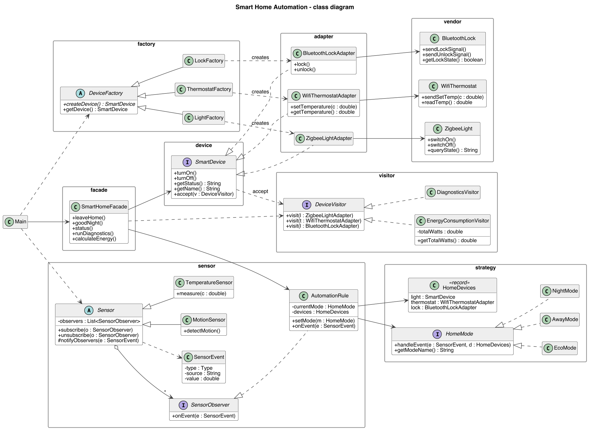

# Smart Home Automation

Final project for the Software Design Patterns course.

A small console app in Java that simulates a smart home. There are three devices
(a Zigbee light, a WiFi thermostat and a Bluetooth door lock) and two sensors
(motion at the front door and temperature in the living room). The house works in
one of three modes, and each mode reacts to the sensors in its own way. For example,
motion in Away mode locks the door and turns the light on, while motion in Night mode
only turns on a night light.

## Team

| Student | Patterns |
|---|---|
| Yernur | Facade, Strategy, Visitor |
| Ramazan | Adapter, Factory Method, Observer |

## Patterns used

| Pattern | Where | What it does here |
|---|---|---|
| Adapter | `adapter/` | Each vendor class has its own API (`switchOn()`, `sendLockSignal()`, `sendSetTemp()`). The adapters wrap them so the rest of the code only sees `SmartDevice`. |
| Factory Method | `factory/` | `DeviceFactory.createDevice()` is overridden by `LightFactory`, `ThermostatFactory` and `LockFactory`. `Main` does not know which vendor class is behind a device. |
| Observer | `sensor/` | Sensors keep a list of `SensorObserver`s and notify them on every reading. `AutomationRule` is the observer. |
| Strategy | `strategy/` | `HomeMode` has three implementations: `EcoMode`, `AwayMode`, `NightMode`. `AutomationRule` passes each sensor event to the current mode, and the mode can be changed at runtime. |
| Facade | `facade/` | `SmartHomeFacade` gives simple methods like `leaveHome()` and `goodNight()` that change the mode and update all three devices in one call. |
| Visitor | `visitor/` | `DiagnosticsVisitor` and `EnergyConsumptionVisitor` add operations over all devices without changing the device classes. |

How they connect:

- Factory creates a vendor object and wraps it in an Adapter.
- A Sensor (Observer) notifies `AutomationRule`, which hands the event to the current `HomeMode` (Strategy).
- The Strategy controls the devices through their adapters.
- The Facade switches the Strategy and runs the Visitors over the devices.

## Project structure

```
src/main/java/SmartHome/
  Main.java            console menu
  device/              SmartDevice interface
  vendor/              fake vendor SDKs (Zigbee, WiFi, Bluetooth)
  adapter/             adapters from vendor classes to SmartDevice
  factory/             device factories
  sensor/              sensors, events, AutomationRule
  strategy/            home modes and HomeDevices
  facade/              SmartHomeFacade
  visitor/             diagnostics and energy visitors
docs/
  uml/                 PlantUML sources and PNG diagrams
  screenshots/         console output screenshots
  report.docx          project report
```

## How to run

You need Java 17 or newer.

```bash
javac -d out $(find src -name "*.java")
java -cp out main.java.SmartHome.Main
```

Or open the folder in IntelliJ IDEA and run `Main`.

## Menu

```
1. Leave home (Away mode)
2. Good night (Night mode)
3. Status
4. Simulate motion sensor
5. Simulate temperature
6. Run diagnostics
7. Energy usage
0. Exit
```

The app starts in Eco mode. A good way to see everything:

1. Press `4`: in Eco mode the light turns on.
2. Press `1` to leave home, then `4` again: the alarm goes off, the door locks, the light turns on.
3. Press `5` and type `5`: Away mode turns on frost protection and sets the thermostat to 12°C.
4. Press `2` for Night mode, then `5` with `15`: the thermostat goes up to 20°C.
5. Press `3` to see the status, then `6` and `7` for the visitors.

## Mode rules

| Mode | Motion | Temperature |
|---|---|---|
| Eco | light on | outside 19-24°C: set thermostat to 21°C |
| Away | lock door, light on, notify owner | below 10°C: set thermostat to 12°C |
| Night | night light on | below 18°C: set 20°C, above 24°C: set 22°C |

## UML

PNG diagrams are in `docs/uml/`. To render them again from the `.puml` files:

```bash
cd docs/uml && plantuml -tpng *.puml
```


